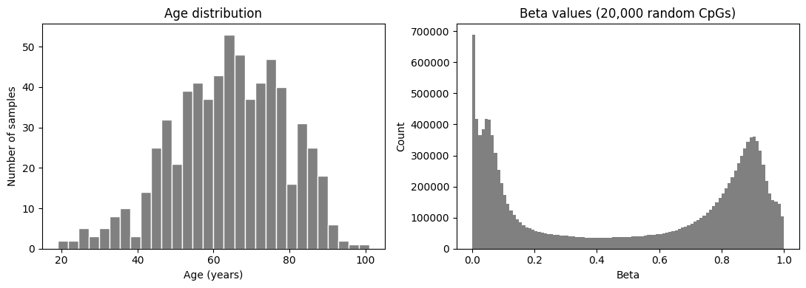
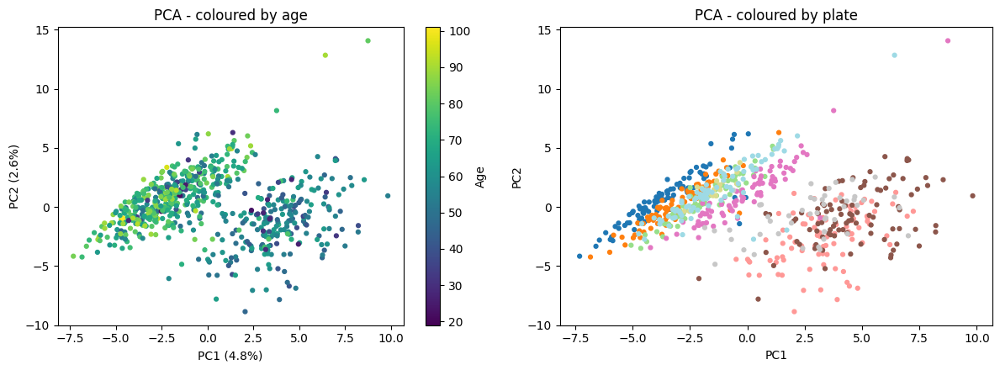

# Age estimation from DNA methylation in blood

Predicting age from DNA methylation (450K array) in Python, and comparing a
full elastic net model with a small 5-CpG panel used in forensic studies.


## Data

Hannum et al. (2013) measured DNA methylation in whole blood from 656 people
aged 19 to 101 on the Illumina HumanMethylation450 array. For each CpG site
the data give a beta value: the fraction of DNA copies that are methylated
at that site (0 = none, 1 = all).

The data are available on GEO under
[GSE40279](https://www.ncbi.nlm.nih.gov/geo/query/acc.cgi?acc=GSE40279).
I used the series matrix file, which the notebook downloads automatically.



Most samples are between 45 and 85 years old.

## Methods

- Removed CpGs missing in more than 5% of samples and filled the remaining
  missing values with the CpG's median, leaving 473,034 CpGs
- Split the samples into a training set (70%, n = 459) and a test set
  (30%, n = 197), stratified by age group. All CpG selection and model tuning
  used the training set only, to avoid data leakage
- Kept the 5,000 CpGs most correlated with age in the training set
- Fitted an elastic net regression (`l1_ratio = 0.5`), choosing the penalty
  strength with 10-fold cross-validation
- For comparison, fitted a linear regression on the 5 CpGs of the forensic panel
  from Zbieć-Piekarska et al. (2015): ELOVL2 (cg16867657), C1orf132 (cg10501210),
  TRIM59 (cg07553761), KLF14 (cg14361627) and FHL2 (cg06639320)
- Evaluated all models on the test set with mean absolute error (MAE)

## Results

### The strongest age marker is ELOVL2


The CpG most correlated with age was cg16867657 in *ELOVL2* (r = 0.86).
FHL2, C1orf132 and TRIM59 CpGs from the forensic panel were also in the top 10 ([full list](results/top10_age_cpgs.csv)).

### A 5-CpG panel is almost as accurate as a 327-CpG model


| Model | CpGs | MAE (years) | RMSE (years) | r |
|---|---|---|---|---|
| Elastic net | 327 | 3.66 | 4.89 | 0.95 |
| Forensic panel | 5 | 4.34 | 5.54 | 0.93 |
| ELOVL2 only | 1 | 5.94 | 7.65 | 0.85 |

The elastic net MAE is close to the 3.9 years reported for the Hannum model.
The 5-CpG panel was 0.7 years worse; ELOVL2 alone was 2.3 years worse.

### Errors are larger in the oldest group


| Age group | Mean absolute error (years) | Test samples |
|---|---|---|
| < 40 | 2.98 | 11 |
| 40–59 | 3.35 | 67 |
| 60–79 | 3.11 | 92 |
| 80+ | 6.59 | 27 |

Error was about twice as high in the 80+ group, and ages in this group were
mostly underestimated. There are relatively few samples over 80 in the
training set.

### Samples cluster by plate



Samples separate by processing plate along PC1 (4.8% of variance), so there
is a batch effect. PC1 also correlates with age (r = −0.43).

## How to run

Open `notebooks/epigenetic_clock.ipynb` in Google Colab and run all cells.
The data is downloaded from GEO. Works on the free Colab tier.
Uses numpy, pandas, matplotlib and scikit-learn.

## Repository structure

```
├── notebooks/
│   └── epigenetic_clock.ipynb   # full analysis with outputs
├── results/
│   ├── model_comparison.csv     # test-set metrics for the three models
│   ├── error_by_age_group.csv   # elastic net error by age group
│   └── top10_age_cpgs.csv       # CpGs most correlated with age
├── figures/                     # distributions, PCA, model plots
└── README.md
```

## References

- Hannum G, Guinney J, Zhao L, et al. Genome-wide methylation profiles reveal
  quantitative views of human aging rates. *Molecular Cell*. 2013;49(2):359–367.
- Zbieć-Piekarska R, Spólnicka M, Kupiec T, et al. Development of a forensically
  useful age prediction method based on DNA methylation analysis.
  *Forensic Science International: Genetics*. 2015;17:173–179.
- Zou H, Hastie T. Regularization and variable selection via the elastic net.
  *Journal of the Royal Statistical Society: Series B*. 2005;67(2):301–320.
