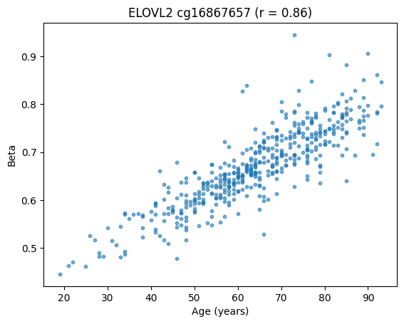
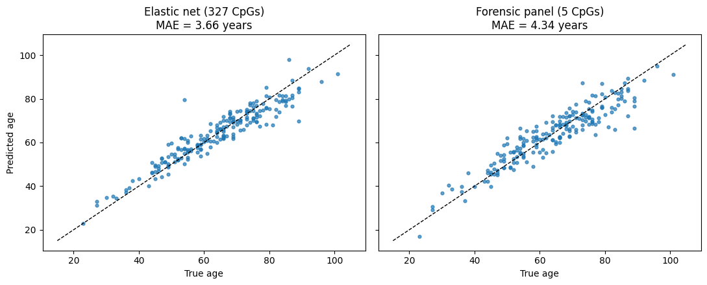
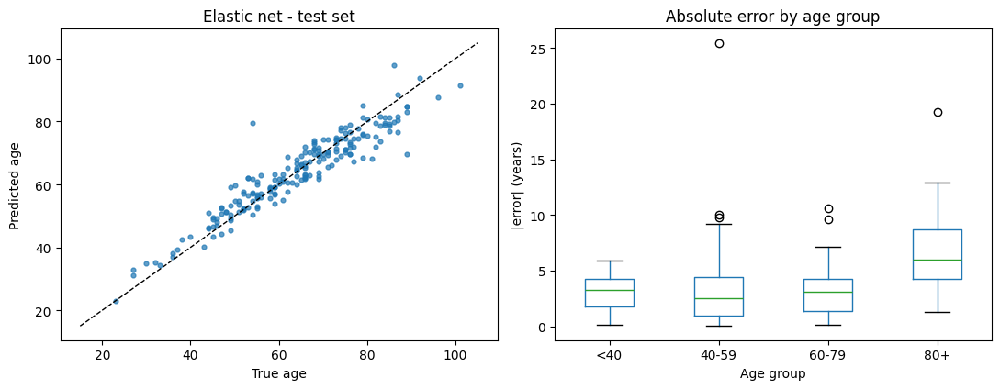

# Age estimation from DNA methylation in blood

An epigenetic clock built from public 450K methylation data in Python.
I used this project to learn how DNA methylation is used for age estimation in
forensic science, and to see how much accuracy is lost when a model with
hundreds of CpG sites is reduced to the handful that forensic labs actually measure.


## Data

Hannum et al. (2013) measured DNA methylation in whole blood from 656 people
aged 19 to 101 on the Illumina HumanMethylation450 array. For each CpG site
the data give a beta value: the fraction of DNA copies that are methylated
at that site (0 = none, 1 = all).

The data are available on GEO under
[GSE40279](https://www.ncbi.nlm.nih.gov/geo/query/acc.cgi?acc=GSE40279).
I used the series matrix file, which the notebook downloads automatically.


Most samples are between 45 and 85 years old; there are few people under 40
and very few over 90.

## Methods

- Removed CpGs missing in more than 5% of samples and filled the remaining
  missing values with the CpG's median, leaving 473,034 CpGs
- Split the samples into a training set (70%, n = 459) and a test set
  (30%, n = 197), stratified by age group. All CpG selection and model tuning
  used the training set only, to avoid data leakage
- Kept the 5,000 CpGs most correlated with age in the training set
- Fitted an elastic net regression (`l1_ratio = 0.5`), choosing the penalty
  strength with 10-fold cross-validation
- For comparison, fitted a linear regression on the 5 CpGs of the forensic panel
  from Zbieć-Piekarska et al. (2015): ELOVL2 (cg16867657), C1orf132 (cg10501210),
  TRIM59 (cg07553761), KLF14 (cg14361627) and FHL2 (cg06639320)
- Evaluated all models on the test set with mean absolute error (MAE)

## Results

### The strongest age marker is ELOVL2



Without giving the analysis any prior knowledge, the CpG most correlated
with age was cg16867657 in *ELOVL2* (r = 0.86), the best-known age marker in
the literature. Its methylation rises from about 45% in the youngest people to
about 80% in the oldest. Three of the other forensic panel CpGs (FHL2, C1orf132
and TRIM59) were also in the top 10, along with further CpGs in *ELOVL2* and
*FHL2* ([full list](results/top10_age_cpgs.csv)).

### A 5-CpG panel is almost as accurate as a 327-CpG model



| Model | CpGs | MAE (years) | RMSE (years) | r |
|---|---|---|---|---|
| Elastic net | 327 | 3.66 | 4.89 | 0.95 |
| Forensic panel | 5 | 4.34 | 5.54 | 0.93 |
| ELOVL2 only | 1 | 5.94 | 7.65 | 0.85 |

The elastic net kept 327 of the 5,000 CpGs and predicted age with an average
error of 3.7 years, similar to the 3.9 years reported for the original Hannum
clock. Going from 327 CpGs to 5 cost only 0.7 years of accuracy, while a single
CpG was clearly worse. For forensic work, where samples are small and only a few
sites can be measured, this suggests a small panel is enough but one marker is not.

### Errors are larger in the oldest group



| Age group | Mean absolute error (years) | Test samples |
|---|---|---|
| < 40 | 2.98 | 11 |
| 40–59 | 3.35 | 67 |
| 60–79 | 3.11 | 92 |
| 80+ | 6.59 | 27 |

The error roughly doubles over age 80, and the model tends to predict these
people as younger than they are. Two likely reasons are that there are few very
old people in the training data, and that methylation differs more between
individuals as they age. In practice, an estimate for an older person would need
a wider error margin.

### Samples cluster by plate


The first principal component (4.8% of the variance) separates the samples
into two groups that follow the plate they were processed on, which points
to a batch effect. PC1 is also correlated with age (r = −0.43), so age and
plate may be partly confounded.

## Limitations

- One dataset only; the test set comes from the same study and lab, so the
  error on data from another lab is likely to be higher
- Probes on the sex chromosomes and probes overlapping SNPs were not removed
- The batch effect seen in the PCA was not corrected
- Blood only and adults only; the model cannot be applied to other tissues
  or to children
- The forensic panel was originally measured by pyrosequencing; here the
  nearest 450K probes were used as a proxy

## How to run

Open `notebooks/epigenetic_clock.ipynb` in
[Google Colab](https://colab.research.google.com/) and choose
**Runtime → Run all**. The notebook downloads the data from GEO (about 1.2 GB)
and runs on the free Colab tier. It uses numpy, pandas, matplotlib and
scikit-learn, which are pre-installed in Colab.

## Repository structure

```
├── notebooks/
│   └── epigenetic_clock.ipynb   # full analysis with outputs
├── results/
│   ├── model_comparison.csv     # test-set metrics for the three models
│   ├── error_by_age_group.csv   # elastic net error by age group
│   └── top10_age_cpgs.csv       # CpGs most correlated with age
├── figures/                     # distributions, PCA, model plots
└── README.md
```

## References

- Hannum G, Guinney J, Zhao L, et al. Genome-wide methylation profiles reveal
  quantitative views of human aging rates. *Molecular Cell*. 2013;49(2):359–367.
- Zbieć-Piekarska R, Spólnicka M, Kupiec T, et al. Development of a forensically
  useful age prediction method based on DNA methylation analysis.
  *Forensic Science International: Genetics*. 2015;17:173–179.
- Zou H, Hastie T. Regularization and variable selection via the elastic net.
  *Journal of the Royal Statistical Society: Series B*. 2005;67(2):301–320.
